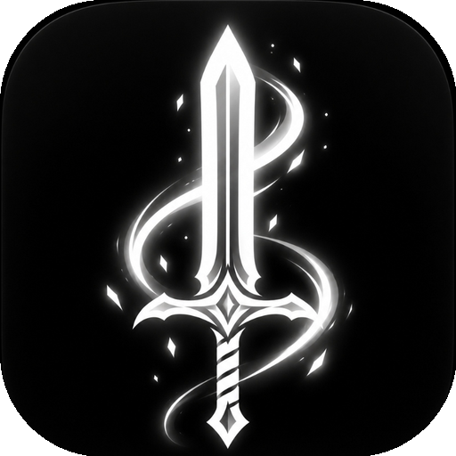

<div align="center">
  
  <h1>Sword Wallpaper</h1>
  <p><strong>Gestor nativo de fondos de pantalla animados y videos para la pantalla de inicio (Lock Screen) en macOS, construido en Rust y Swift/Metal con aceleración por hardware.</strong></p>

  <p>
    
    
    
    <a href="LICENSE"></a>
  </p>

  <p>
    <a href="https://ko-fi.com/robb004" target="_blank">
      
    </a>
  </p>
</div>

---

## Características Principales

- **Fondo de Pantalla Animado en Escritorio:** Reproducción continua y fluida en bucle de videos (`MP4`, `MOV`, `MKV`, `WEBM`) e imágenes estáticas directamente sobre la capa del escritorio de macOS (`Desktop Layer`), con mínimo consumo de CPU gracias a `AVFoundation` y `VideoToolbox`.
- **Video en Pantalla de Inicio y Bloqueo (Lock Screen Aerials):** Conversión e integración nativa con el sistema de salvapantallas **Aerials** de macOS (`WallpaperAgent` / `WallpaperAerialsExtension`), permitiendo que tus videos animados también cobren vida en la **pantalla de inicio de sesión y bloqueo**.
- **Modo Panal (Honeycomb HUD):** Selector visual flotante en panal hexagonal con acceso rápido a tus fondos favoritos, botón superior derecho `⚙ Ajustes` para abrir la configuración completa y cierre limpio (`✕`) manteniendo el servicio en segundo plano.
- **Exclusión Mutua de Ventanas y Segundo Plano Real:** La ventana de ajustes y el modo panal nunca se superponen; al cerrar las ventanas la aplicación permanece activa en la barra de menú de macOS mientras los fondos siguen reproduciéndose, y se cierra de forma segura al apagar o reiniciar el equipo.
- **Soporte Multi-Monitor y Replicación Simultánea:** Visualizador interactivo de pantallas para configurar fondos y escalado (`Ajustar`, `Rellenar`, `Estirar`) de forma independiente por monitor o replicar el mismo fondo en **Todas las pantallas** a la vez.
- **Catálogo Online Integrado:** Explora y descarga fondos directamente desde **MotionBGS (Live 4K/HD)**, **Wallhaven**, **Bing del Día** y **Minimalista**.
- **Pausa Inteligente y Control Total:** Pausa automática cuando hay aplicaciones a pantalla completa o juegos activos (`Smart Pause`), rotación programada, control de volumen/silencio y autoinicio con macOS (`LaunchAgents`).

---

## ¿Cómo Funciona?

**Sword Wallpaper** combina una interfaz de gestión nativa en **Rust** (`libcosmic` / `iced` + puente Cocoa/Objective-C en `tray_macos.m`) con un motor de renderizado ligero en **Swift** (`aura-bg`, compilado desde `src/engine/macos_bg.swift`):

### 1. Motor de Fondo de Pantalla de Escritorio (`aura-bg`)
- **Capa de Escritorio Nativa:** `aura-bg` crea ventanas `NSWindow` sin bordes (`canBecomeKey = false`, `canBecomeMain = false`) ancladas por detrás de los iconos del escritorio en cada `NSScreen` detectado.
- **Reproducción Sincronizada GPU:** Utiliza `AVQueuePlayer` junto con `AVPlayerLooper` y capas `AVPlayerLayer` compartidas para reproducir el video en bucle sin cortes ni parpadeos, replicando la reproducción sincronizada en múltiples monitores cuando se selecciona `Todas las pantallas` (`*`).
- **Control IPC en Tiempo Real:** Se comunica mediante sockets Unix JSON-IPC (`/Users/<usuario>/.cache/aura/ipc/`) para cambiar de video instantáneamente, pausar, reanudar, ajustar volumen o modificar el modo de escalado (`fit`, `fill`, `stretch`) sin reiniciar el proceso.

### 2. Motor de Video para Pantalla de Inicio / Bloqueo (Lock Screen)
- **Conversión Temporal HEVC (`--prepare-lockscreen`):** Cuando aplicas un video como fondo de pantalla en macOS, Sword Wallpaper encola una tarea en segundo plano que invoca `aura-bg --prepare-lockscreen` usando `TemporalWallpaperWriter` (`AVAssetWriter` + `VideoToolbox` HEVC).
- **Integración con Aerials de macOS:** El video optimizado se registra y vincula por **UUID de cada pantalla física** dentro de la infraestructura nativa de `WallpaperAgent` / `WallpaperAerialsExtension` de macOS.
- **Resultado:** Tanto al bloquear la pantalla como en la pantalla de inicio de sesión tras encender o cerrar sesión en tu Mac, el video seleccionado se reproduce de manera nativa en la pantalla de inicio, y al desbloquear continúa sin interrupciones en el escritorio.

### 3. Ciclo de Vida, Barra de Menú y Apagado del Sistema
- **Servicio en Segundo Plano:** Al cerrar la ventana principal o el panal, el reproductor `aura-bg` y el controlador de bandeja (`NSStatusItem` en la barra superior de macOS) permanecen activos.
- **Apagado Limpio del Mac:** Escucha `NSWorkspaceWillPowerOffNotification`, `applicationShouldTerminate:` y señales Unix (`SIGTERM` / `SIGINT`) para detener ordenadamente los procesos de video y salir sin bloquear el apagado o reinicio de macOS.

---

## Compilación e Instalación en macOS

### Requisitos Previos
- **macOS 13.0+** (Apple Silicon M1–M4 o Intel)
- **Xcode Command Line Tools** (`swiftc`, `clang`, `codesign`)
- **Rust / Cargo** (`rustup`)

### Empaquetado Rápido (`.app` firmado)
```bash
./scripts/package-macos.sh
```
Este script compila `aura` y `aura-bg` en modo `--release`, genera el bundle `target/Sword Wallpaper.app` con su helper `Aura Wallpaper.app` embebido, firma ambos bundles con `codesign` y verifica la integridad de la firma.

Para instalarlo en tu carpeta de Aplicaciones (si ya existe una versión, ciérrala y muévela a la Papelera desde Finder):
```bash
cp -R "target/Sword Wallpaper.app" "/Applications/"
```

---

## Estructura del Proyecto

```text
SwordWallpaper/
├── src/
│   ├── main.rs                  # Punto de entrada, CLI e instancia única
│   ├── app.rs                   # Estado global, ventanas, ciclo de vida e IPC
│   ├── config.rs                # Persistencia de configuración y migraciones
│   ├── cli.rs                   # Comandos CLI y comunicación por socket IPC
│   ├── tray.rs                  # Controlador de bandeja multi-plataforma
│   ├── tray_macos.m             # Puente nativo Cocoa/AppKit (Menú Bar y ciclo macOS)
│   ├── i18n.rs                  # Traducciones (Español / Inglés)
│   ├── system.rs                # Detección de apps a pantalla completa y batería
│   ├── engine/
│   │   ├── macos_bg.swift       # Motor nativo AVFoundation/VideoToolbox + LockScreen HEVC
│   │   ├── mpvpaper.rs          # Orquestación de procesos e IPC del motor
│   │   ├── outputs.rs           # Detección de pantallas y resolución en macOS
│   │   └── gpu.rs               # Gestión de aceleración hardware
│   ├── online/                  # Clientes de catálogos (MotionBGS, Wallhaven, Bing, Minimalista)
│   ├── scanner/                 # Escáner de biblioteca y generador de miniaturas
│   ├── theme/                   # Motor de temas visuales
│   └── ui/                      # Vistas de interfaz (Panal, Biblioteca, Explorar, Pantallas, Ajustes)
├── resources/                   # Iconos .icns, iconos de barra de menú y fondos UI
├── scripts/
│   ├── package-macos.sh         # Empaquetador y firmador oficial .app para macOS
│   └── check-lockscreen.py      # Utilidad de verificación de estado de Lock Screen
├── Cargo.toml                   # Manifiesto del proyecto Rust (MIT)
├── build.rs                     # Compilación automática de macos_bg.swift y tray_macos.m
├── CHANGELOG.md                 # Historial de versiones y mejoras
├── LICENSE                      # Licencia MIT
└── README.md                    # Documentación del proyecto
```

---

## Licencia

Distribuido bajo la licencia **MIT** — Consulta el archivo [LICENSE](LICENSE) para más detalles.

---

<div align="center">
  <p>Si <strong>Sword Wallpaper</strong> te resulta útil en tu Mac, puedes apoyar su desarrollo continuo:</p>
  <a href="https://ko-fi.com/robb004" target="_blank">
    
  </a>
</div>
